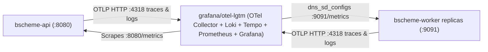
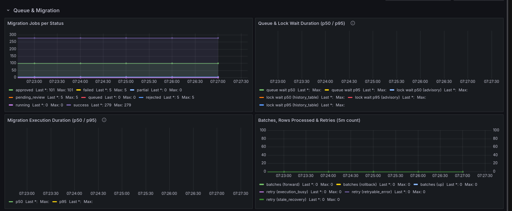
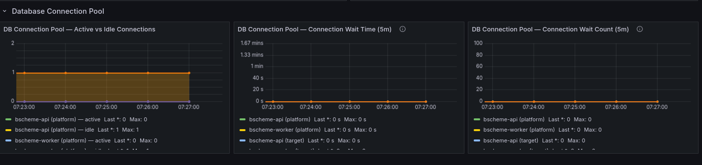
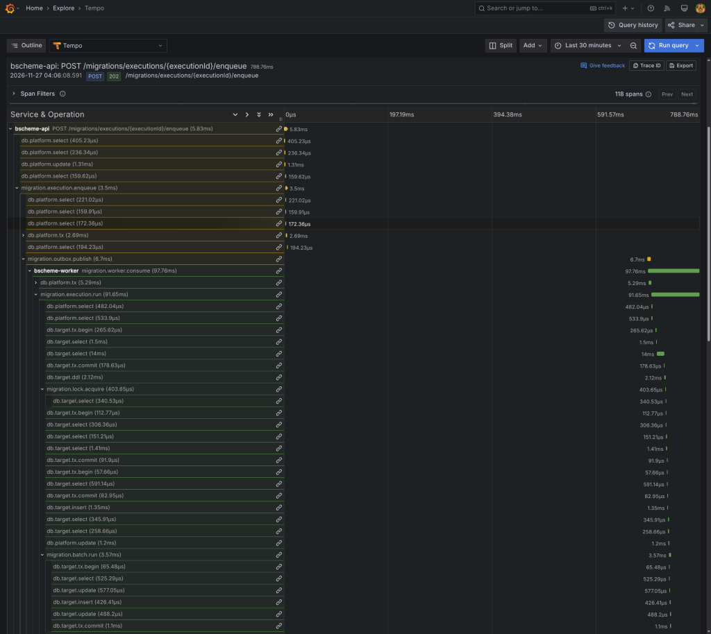

# BScheme Observability (Single-Container `grafana/otel-lgtm`)

Centralized structured logging, distributed tracing, Prometheus metrics, and auto-provisioned Grafana dashboard for `bscheme-api` (`cmd/server`) and `bscheme-worker` (`cmd/worker`), powered by the single all-in-one [`grafana/otel-lgtm`](https://github.com/grafana/docker-otel-lgtm) container (`lgtm`).

## Architecture



## Configuration Files

| File | Container Mount Path | Purpose |
| --- | --- | --- |
| [`prometheus.yml`](prometheus.yml) | `/otel-lgtm/prometheus.yaml` | Scrapes `internal:8080/metrics` (`bscheme-api`) and discovers every `worker` replica on `:9091/metrics` via `dns_sd_configs` |
| [`dashboards.yml`](dashboards.yml) | `/otel-lgtm/grafana/conf/provisioning/dashboards/grafana-dashboards.yaml` | Auto-provisions dashboards into Grafana folder **BScheme** |
| [`bscheme-migrations.json`](bscheme-migrations.json) | `/otel-lgtm/dashboards/bscheme-migrations.json` | **BScheme — Queue, Migrations & DB Connection Pool** dashboard (also default home dashboard) |

`grafana/otel-lgtm` bundles the OpenTelemetry Collector (`:4317` gRPC, `:4318` HTTP), Loki (`:3100`), Tempo (`:3200`), Prometheus (`:9090`), and Grafana (`:3000`, default `admin` / `admin`) with Prometheus, Tempo, and Loki datasources and trace-to-logs correlation pre-configured.

## Running the Stack

```bash
cp .env.example .env
docker compose up --build -d --scale worker=3
bash scripts/test-observability.sh
```

Exposed endpoints:
- **Grafana**: `http://localhost:3000` (loads **BScheme — Queue, Migrations & DB Connection Pool** at `/d/bscheme-migrations`)
- **Prometheus**: `http://localhost:9090/targets`
- **API `/metrics`**: `http://localhost:8080/metrics`
- **Worker `/metrics`**: `:9091/metrics` (`/healthz` for liveness) is exposed only inside the Compose network (`expose: ["9091"]`) so `docker compose up --scale worker=N` never collides on a host port. Prometheus discovers all replicas via Compose DNS `A` records (`dns_sd_configs` on `worker:9091`).
- **OTLP Receiver**: `http://localhost:4318` (HTTP) / `localhost:4317` (gRPC)
- **Loki / Tempo APIs**: `http://localhost:3100`, `http://localhost:3200`

### Environment Variables

| Variable | Default | Description |
| --- | --- | --- |
| `OTEL_SERVICE_NAME` | `bscheme-api` / `bscheme-worker` | Logical OTel service name resource attribute |
| `OTEL_SERVICE_VERSION` | `dev` | Build/release version resource attribute |
| `OTEL_ENVIRONMENT` / `APP_ENV` | `development` | Deployment environment resource attribute |
| `OTEL_EXPORTER_OTLP_ENDPOINT` | `""` (`http://lgtm:4318` in Compose) | OTLP/HTTP base URL; when unset, OTLP export is skipped gracefully |
| `OTEL_TRACES_EXPORTER` | `""` (OTLP if endpoint set) | `otlp`, `console` (JSON spans to `stderr`), `otlp,console`, or `none` |
| `OTEL_TRACES_SAMPLER_ARG` | `1.0` | Parent-based trace sampling ratio (`0.0`..`1.0`) |
| `APP_METRICS_ADDR` | `:9091` | Worker HTTP bind address serving `/metrics` and `/healthz` (fixed to `:9091` in Compose to match `dns_sd_configs`) |

## Label Cardinality Policy

All Prometheus metrics restrict labels to bounded enumerations so time-series cardinality cannot explode:

| Allowed Bounded Labels | Explicitly Prohibited Labels |
| --- | --- |
| `type` (`up`, `rollback`, `forward`, `unknown`), `status` (11 bounded lifecycle states) | `user_id`, `session_id` |
| `lock_scope` (`advisory`, `history_table`), `reason` (`retryable_error`, `stale_recovery`, `execution_busy`) | `execution_id` / `job_id`, `draft_id`, `database_id` |
| `db_role` (`platform`, `target`), `state` (`active`, `idle`) | Raw SQL statements, bind values, or raw request paths |

High-cardinality identifiers (`execution_id`, `database_id`, `attempt`, `batch_number`) and redacted SQL shapes (`SanitizeSQL`) are recorded exclusively in structured logs (`log/slog`) and OpenTelemetry span attributes.

## Exposed Metrics & Dashboard Mapping

| Spec Requirement | Prometheus Metric(s) | Grafana Panel (`bscheme-migrations`) |
| --- | --- | --- |
| Jobs per Status (Waiting / Running / Succeeded / Failed) | `bscheme_migration_jobs{status}`, `bscheme_migration_executions_total{type,status}` | **Migration Jobs per Status** |
| Queue & Lock Wait Duration | `bscheme_migration_queue_wait_duration_seconds_{bucket,sum,count}{type}`, `bscheme_migration_lock_wait_duration_seconds_{bucket,sum,count}{type,lock_scope}` | **Queue & Lock Wait Duration (p50 / p95)** |
| Migration Duration | `bscheme_migration_execution_duration_seconds_{bucket,sum,count}{type,status}` | **Migration Execution Duration (p50 / p95)** |
| Batches, Rows Processed & Retries | `bscheme_migration_batches_processed_total{type}`, `bscheme_migration_batch_rows_processed_total{type}`, `bscheme_migration_retries_total{type,reason}` | **Batches, Rows Processed & Retries** |
| DB Pool Active / Idle | `bscheme_db_pool_connections{db_role,state}` | **DB Connection Pool — Active vs Idle Connections** |
| DB Pool Wait Time & Count | `bscheme_db_pool_wait_duration_seconds_total{db_role}`, `bscheme_db_pool_wait_count_total{db_role}` | **DB Connection Pool — Connection Wait Time**, **DB Connection Pool — Connection Wait Count** |

## Grafana Screenshots

- **Queue, Migrations & Wait Durations** (`http://localhost:3000/d/bscheme-migrations`):

  

- **Database Connection Pools** (`http://localhost:3000/d/bscheme-migrations`):

  

- **Centralized Structured Logs & Trace Link in Loki** (`{service_name=~"bscheme-api|bscheme-worker"} | trace_id = "e8d5ed88aa0ef122e701672d1cfeb39e"`):

  

- **End-to-End Distributed Trace in Tempo** (`e8d5ed88aa0ef122e701672d1cfeb39e` across `bscheme-api` -> `Outbox` -> `RabbitMQ` -> `bscheme-worker` -> `PostgreSQL`):

  

## Verified Log, Trace Correlation & Metric Examples

All application logs are emitted as structured JSON (`log/slog`) to `stdout` (not stored in Platform DB) and forwarded via OpenTelemetry Collector inside `lgtm` to Loki. Every attempt (including failures and retries), target SQL transaction (`sql.tx.started`, `sql.tx.commit`, `sql.tx.rollback`), and query (`sql.query.started`, `sql.query.completed`, `sql.query.failed` with `sqlstate`) shares `trace_id`, `span_id`, `correlation_id`, `actor`, and `database`, with sensitive literals and DSN credentials scrubbed to `[REDACTED]`.

### 1. End-to-End Trace & Log Correlation (`API -> Outbox -> RabbitMQ -> Worker -> Lock -> Batch -> DB`)

**Structured JSON logs (`stdout` / Loki)**:

```json
{"time":"2026-11-26T13:08:19.473354551+07:00","level":"INFO","msg":"migration execution queued","service":"bscheme-api","event":"migration.execution.queued","status":"queued","actor":"user:7","database":"target:3","correlation_id":"corr-e2e-42","trace_id":"9871a7b640c675d32f440379d6495659","span_id":"ca06bb1a74a222a3","execution_id":42,"draft_id":15}
{"time":"2026-11-26T13:08:19.473535312+07:00","level":"INFO","msg":"published migration execution to queue","service":"bscheme-api","event":"migration.outbox.published","queue":"migration.executions","status":"ok","duration_ms":3.412,"actor":"system:outbox-relay","database":"platform","correlation_id":"corr-e2e-42","trace_id":"9871a7b640c675d32f440379d6495659","span_id":"d293452fcc70efdc","execution_id":42}
{"time":"2026-11-26T13:08:19.473599625+07:00","level":"INFO","msg":"migration execution started","service":"bscheme-worker","event":"migration.execution.started","queue_wait_ms":18,"status":"started","actor":"user:7","database":"target:3","correlation_id":"corr-e2e-42","trace_id":"9871a7b640c675d32f440379d6495659","span_id":"aa080b7e08264808","execution_id":42,"draft_id":15,"attempt":1}
{"time":"2026-11-26T13:08:19.47362904+07:00","level":"INFO","msg":"migration target lock acquired","service":"bscheme-worker","event":"migration.lock.acquired","lock_scope":"advisory","status":"ok","duration_ms":1.205,"actor":"user:7","database":"target:3","correlation_id":"corr-e2e-42","trace_id":"9871a7b640c675d32f440379d6495659","span_id":"40a2d88c6a48cb9f","execution_id":42,"draft_id":15,"attempt":1}
{"time":"2026-11-26T13:08:19.473683792+07:00","level":"INFO","msg":"database transaction started","service":"bscheme-worker","event":"sql.tx.started","database":"target:3","status":"started","query":"begin","actor":"user:7","correlation_id":"corr-e2e-42","trace_id":"9871a7b640c675d32f440379d6495659","span_id":"48a29b4373d0a83e","execution_id":42,"draft_id":15,"attempt":1,"batch_number":1}
{"time":"2026-11-26T13:08:19.473878702+07:00","level":"INFO","msg":"sql query completed","service":"bscheme-worker","database":"target:3","operation":"update","query":"UPDATE public.orders SET status = '[REDACTED]' WHERE id = ANY($1)","duration_ms":0,"parameters":[[101,102]],"rows_affected":2,"event":"sql.query.completed","status":"ok","actor":"user:7","correlation_id":"corr-e2e-42","trace_id":"9871a7b640c675d32f440379d6495659","span_id":"aefcb2a8deb00143","execution_id":42,"draft_id":15,"attempt":1,"batch_number":1}
{"time":"2026-11-26T13:08:19.472235067+07:00","level":"ERROR","msg":"sql query failed","service":"bscheme-worker","database":"target:3","operation":"update","query":"UPDATE public.orders SET code = '[REDACTED]' WHERE id = $1","duration_ms":0,"parameters":[101],"event":"sql.query.failed","status":"error","error":": duplicate key value violates unique constraint (SQLSTATE 23505)","sqlstate":"23505","actor":"user:7","correlation_id":"corr-sql-42","trace_id":"eb39a11df7372307ce0892d6cea42ce2","span_id":"0c187d92745e5108","execution_id":42,"draft_id":15,"attempt":1,"batch_number":2}
{"time":"2026-11-26T13:08:19.473980714+07:00","level":"INFO","msg":"database transaction committed","service":"bscheme-worker","event":"sql.tx.commit","database":"target:3","status":"committed","query":"commit","duration_ms":0,"actor":"user:7","correlation_id":"corr-e2e-42","trace_id":"9871a7b640c675d32f440379d6495659","span_id":"deb71cbaed91e008","execution_id":42,"draft_id":15,"attempt":1,"batch_number":1}
{"time":"2026-11-26T13:08:19.474033776+07:00","level":"INFO","msg":"migration batch committed","service":"bscheme-worker","event":"migration.batch.committed","rows_affected":2,"status":"committed","duration_ms":12.6,"actor":"user:7","database":"target:3","correlation_id":"corr-e2e-42","trace_id":"9871a7b640c675d32f440379d6495659","span_id":"3b4831946d19eefb","execution_id":42,"draft_id":15,"attempt":1,"batch_number":1}
{"time":"2026-11-26T13:08:19.474069104+07:00","level":"INFO","msg":"migration execution succeeded","service":"bscheme-worker","event":"migration.execution.completed","execution_type":"up","execution_status":"success","version":7,"status":"ok","duration_ms":19.8,"actor":"user:7","database":"target:3","correlation_id":"corr-e2e-42","trace_id":"9871a7b640c675d32f440379d6495659","span_id":"aa080b7e08264808","execution_id":42,"draft_id":15,"attempt":1}
```

**OpenTelemetry Console Span Exporter JSON (`OTEL_TRACES_EXPORTER=console`, `stderr`)**:

```json
{"type":"otel_span","service":"bscheme","trace_id":"9871a7b640c675d32f440379d6495659","span_id":"ca06bb1a74a222a3","name":"POST /migrations/executions/{executionId}/enqueue","kind":"server","start_time":"2026-11-26T06:08:19.473348383Z","end_time":"2026-11-26T06:08:19.473398575Z","duration_ms":0.05,"status_code":"Unset","attributes":{"http.route":"/migrations/executions/{executionId}/enqueue"}}
{"type":"otel_span","service":"bscheme","trace_id":"9871a7b640c675d32f440379d6495659","span_id":"d293452fcc70efdc","parent_span_id":"ca06bb1a74a222a3","name":"migration.outbox.publish","kind":"producer","start_time":"2026-11-26T06:08:19.473530497Z","end_time":"2026-11-26T06:08:19.4735721Z","duration_ms":0.041,"status_code":"Unset","attributes":{"messaging.system":"rabbitmq"}}
{"type":"otel_span","service":"bscheme","trace_id":"9871a7b640c675d32f440379d6495659","span_id":"40a2d88c6a48cb9f","parent_span_id":"aa080b7e08264808","name":"migration.lock.acquire","kind":"internal","start_time":"2026-11-26T06:08:19.473623926Z","end_time":"2026-11-26T06:08:19.473653444Z","duration_ms":0.029,"status_code":"Unset","attributes":{"migration.lock_scope":"advisory"}}
{"type":"otel_span","service":"bscheme","trace_id":"9871a7b640c675d32f440379d6495659","span_id":"48a29b4373d0a83e","parent_span_id":"3b4831946d19eefb","name":"db.target.tx.begin","kind":"client","start_time":"2026-11-26T06:08:19.473679319Z","end_time":"2026-11-26T06:08:19.473711443Z","duration_ms":0.032,"status_code":"Unset","attributes":{"db.operation.name":"tx","db.role":"target","db.rows_affected":0,"db.system.name":"postgresql","db.target_database_id":3,"migration.attempt":1,"migration.batch_number":1,"migration.execution_id":42}}
{"type":"otel_span","service":"bscheme","trace_id":"9871a7b640c675d32f440379d6495659","span_id":"aefcb2a8deb00143","parent_span_id":"3b4831946d19eefb","name":"db.target.update","kind":"client","start_time":"2026-11-26T06:08:19.473786889Z","end_time":"2026-11-26T06:08:19.473938606Z","duration_ms":0.151,"status_code":"Unset","attributes":{"db.operation.name":"update","db.role":"target","db.rows_affected":2,"db.system.name":"postgresql","db.target_database_id":3,"migration.attempt":1,"migration.batch_number":1,"migration.execution_id":42}}
{"type":"otel_span","service":"bscheme","trace_id":"9871a7b640c675d32f440379d6495659","span_id":"deb71cbaed91e008","parent_span_id":"3b4831946d19eefb","name":"db.target.tx.commit","kind":"client","start_time":"2026-11-26T06:08:19.473970937Z","end_time":"2026-11-26T06:08:19.474006176Z","duration_ms":0.035,"status_code":"Unset","attributes":{"db.operation.name":"tx","db.role":"target","db.rows_affected":0,"db.system.name":"postgresql","db.target_database_id":3,"migration.attempt":1,"migration.batch_number":1,"migration.execution_id":42}}
{"type":"otel_span","service":"bscheme","trace_id":"9871a7b640c675d32f440379d6495659","span_id":"3b4831946d19eefb","parent_span_id":"aa080b7e08264808","name":"migration.batch.run","kind":"internal","start_time":"2026-11-26T06:08:19.473668623Z","end_time":"2026-11-26T06:08:19.474057648Z","duration_ms":0.389,"status_code":"Unset","attributes":{"migration.batch_number":1}}
{"type":"otel_span","service":"bscheme","trace_id":"9871a7b640c675d32f440379d6495659","span_id":"aa080b7e08264808","parent_span_id":"d2a0a141bfc3ba0c","name":"migration.execution.run","kind":"internal","start_time":"2026-11-26T06:08:19.473594557Z","end_time":"2026-11-26T06:08:19.474096155Z","duration_ms":0.501,"status_code":"Unset"}
{"type":"otel_span","service":"bscheme","trace_id":"9871a7b640c675d32f440379d6495659","span_id":"d2a0a141bfc3ba0c","parent_span_id":"d293452fcc70efdc","name":"migration.worker.consume","kind":"consumer","start_time":"2026-11-26T06:08:19.473592256Z","end_time":"2026-11-26T06:08:19.474101143Z","duration_ms":0.508,"status_code":"Unset","attributes":{"messaging.system":"rabbitmq"}}
```

LogQL correlation query in Grafana -> Explore -> **Loki**:

```logql
{service_name=~"bscheme-api|bscheme-worker"} | trace_id = "9871a7b640c675d32f440379d6495659"
```

### 2. Verified Prometheus `/metrics` Exposition Excerpt

```prometheus
bscheme_db_pool_connections{db_role="platform",state="active"} 0
bscheme_db_pool_connections{db_role="platform",state="idle"} 0
bscheme_db_pool_connections{db_role="target",state="active"} 3
bscheme_db_pool_connections{db_role="target",state="idle"} 4
bscheme_db_pool_wait_count_total{db_role="platform"} 0
bscheme_db_pool_wait_count_total{db_role="target"} 1
bscheme_db_pool_wait_duration_seconds_total{db_role="platform"} 0
bscheme_db_pool_wait_duration_seconds_total{db_role="target"} 0.045
bscheme_migration_jobs{status="pending_review"} 1
bscheme_migration_jobs{status="rejected"} 0
bscheme_migration_jobs{status="approved"} 2
bscheme_migration_jobs{status="queued"} 3
bscheme_migration_jobs{status="running"} 1
bscheme_migration_jobs{status="success"} 14
bscheme_migration_jobs{status="failed"} 1
bscheme_migration_jobs{status="partial"} 0
bscheme_migration_executions_total{status="success",type="up"} 1
bscheme_migration_execution_duration_seconds_sum{status="success",type="up"} 2.4
bscheme_migration_execution_duration_seconds_count{status="success",type="up"} 1
bscheme_migration_queue_wait_duration_seconds_sum{type="up"} 0.12
bscheme_migration_queue_wait_duration_seconds_count{type="up"} 1
bscheme_migration_lock_wait_duration_seconds_sum{lock_scope="advisory",type="up"} 0.018
bscheme_migration_lock_wait_duration_seconds_sum{lock_scope="history_table",type="up"} 0.009
bscheme_migration_retries_total{reason="retryable_error",type="up"} 1
bscheme_migration_batches_processed_total{type="up"} 1
bscheme_migration_batch_rows_processed_total{type="up"} 500
```
