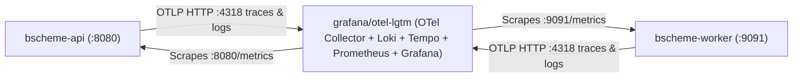
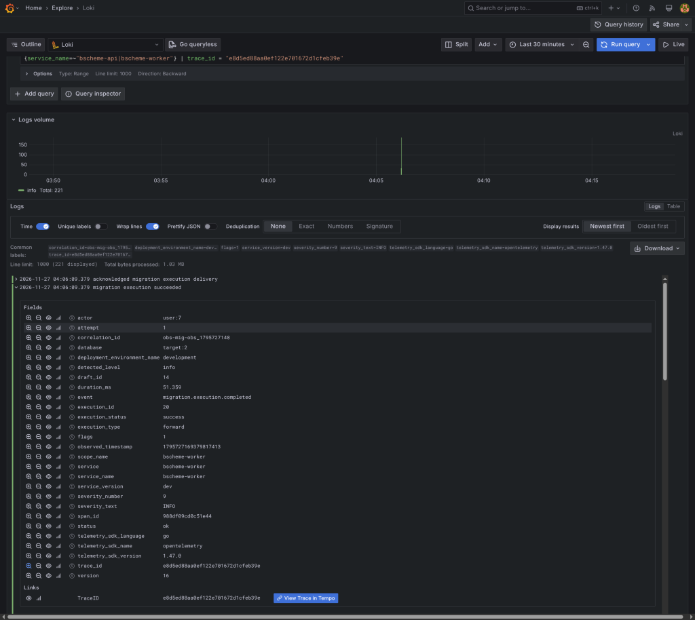

# BScheme Observability (Single-Container `grafana/otel-lgtm`)

Centralized structured logging, distributed tracing, Prometheus metrics, and auto-provisioned Grafana dashboard for `bscheme-api` (`cmd/server`) and `bscheme-worker` (`cmd/worker`), powered by the single all-in-one [`grafana/otel-lgtm`](https://github.com/grafana/docker-otel-lgtm) container (`lgtm`).

## Architecture



## Configuration Files

| File | Container Mount Path | Purpose |
| --- | --- | --- |
| [`prometheus.yml`](prometheus.yml) | `/otel-lgtm/prometheus.yaml` | Scrapes `internal:8080/metrics` (`bscheme-api`) and `worker:9091/metrics` (`bscheme-worker`) |
| [`dashboards.yml`](dashboards.yml) | `/otel-lgtm/grafana/conf/provisioning/dashboards/grafana-dashboards.yaml` | Auto-provisions dashboards into Grafana folder **BScheme** |
| [`bscheme-migrations.json`](bscheme-migrations.json) | `/otel-lgtm/dashboards/bscheme-migrations.json` | **BScheme — Queue, Migrations & DB Connection Pool** dashboard (also default home dashboard) |

`grafana/otel-lgtm` bundles the OpenTelemetry Collector (`:4317` gRPC, `:4318` HTTP), Loki (`:3100`), Tempo (`:3200`), Prometheus (`:9090`), and Grafana (`:3000`, default `admin` / `admin`) with Prometheus, Tempo, and Loki datasources and trace-to-logs correlation pre-configured.

## Running the Stack

```bash
cp .env.example .env
docker compose up --build -d
bash scripts/test-observability.sh
```

Exposed endpoints:
- **Grafana**: `http://localhost:3000` (loads **BScheme — Queue, Migrations & DB Connection Pool** at `/d/bscheme-migrations`)
- **Prometheus**: `http://localhost:9090/targets`
- **API `/metrics`**: `http://localhost:8080/metrics`
- **Worker `/metrics`**: `http://localhost:9091/metrics` (`/healthz` for liveness)
- **OTLP Receiver**: `http://localhost:4318` (HTTP) / `localhost:4317` (gRPC)
- **Loki / Tempo APIs**: `http://localhost:3100`, `http://localhost:3200`

### Environment Variables

| Variable | Default | Description |
| --- | --- | --- |
| `OTEL_SERVICE_NAME` | `bscheme-api` / `bscheme-worker` | Logical OTel service name resource attribute |
| `OTEL_SERVICE_VERSION` | `dev` | Build/release version resource attribute |
| `OTEL_ENVIRONMENT` / `APP_ENV` | `development` | Deployment environment resource attribute |
| `OTEL_EXPORTER_OTLP_ENDPOINT` | `""` (`http://lgtm:4318` in Compose) | OTLP/HTTP base URL; when unset, OTLP export is skipped gracefully |
| `OTEL_TRACES_EXPORTER` | `""` (OTLP if endpoint set) | `otlp`, `console` (JSON spans to `stderr`), `otlp,console`, or `none` |
| `OTEL_TRACES_SAMPLER_ARG` | `1.0` | Parent-based trace sampling ratio (`0.0`..`1.0`) |

## Exposed Metrics & Dashboard Mapping

| Spec Requirement | Prometheus Metric(s) | Grafana Panel (`bscheme-migrations`) |
| --- | --- | --- |
| Jobs per Status (Waiting / Running / Succeeded / Failed) | `bscheme_migration_jobs{status}`, `bscheme_migration_executions_total{type,status}` | **Migration Jobs per Status** |
| Queue & Lock Wait Duration | `bscheme_migration_queue_wait_duration_seconds_{bucket,sum,count}{type}`, `bscheme_migration_lock_wait_duration_seconds_{bucket,sum,count}{type,lock_scope}` | **Queue & Lock Wait Duration (p50 / p95)** |
| Migration Duration | `bscheme_migration_execution_duration_seconds_{bucket,sum,count}{type,status}` | **Migration Execution Duration (p50 / p95)** |
| Batches, Rows Processed & Retries | `bscheme_migration_batches_processed_total{type}`, `bscheme_migration_batch_rows_processed_total{type}`, `bscheme_migration_retries_total{type,reason}` | **Batches, Rows Processed & Retries (5m count)** |
| DB Pool Active / Idle | `bscheme_db_pool_connections{db_role,state}` | **DB Connection Pool — Active vs Idle Connections** |
| DB Pool Wait Time & Count | `bscheme_db_pool_wait_duration_seconds_total{db_role}`, `bscheme_db_pool_wait_count_total{db_role}` | **DB Connection Pool — Connection Wait Time (5m)**, **DB Connection Pool — Connection Wait Count (5m)** |

## Grafana Screenshots

- **Queue, Migrations & Wait Durations** (`http://localhost:3000/d/bscheme-migrations`):

  

- **Throughput, Batches/Rows & DB Connection Pools** (`http://localhost:3000/d/bscheme-migrations`):

  

- **Centralized Structured Logs & Trace Link in Loki** (`{service_name=~"bscheme-api|bscheme-worker"} | trace_id = "e8d5ed88aa0ef122e701672d1cfeb39e"`):

  

- **End-to-End Distributed Trace in Tempo** (`e8d5ed88aa0ef122e701672d1cfeb39e` across `bscheme-api` -> `Outbox` -> `RabbitMQ` -> `bscheme-worker` -> `PostgreSQL`):

  